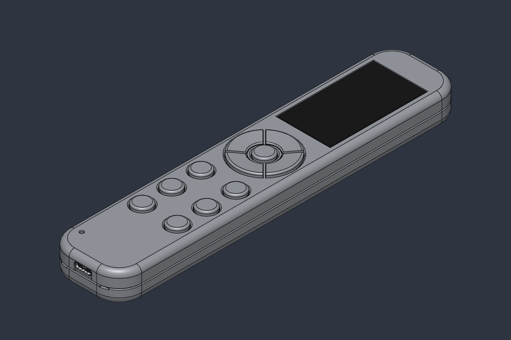

# ZMK Universal Remote

A simple remote for a living-room HTPC. Off-the-shelf remotes tend to feel cheap and lack the simple navigation people now expect from a streaming box. This remote has only the basic buttons a streaming box remote has: a D-pad, back, home and media controls. A touchscreen adds Home Assistant controls and a touchpad.

This repository contains the PCB, the 3D-printable case and the [ZMK](https://zmk.dev/) firmware.



## Features

- **Streaming-box button layout:** a 5-way D-pad plus six buttons for navigation and media. There are no rows of rarely used buttons.
- **Quiet, soft-feeling buttons:** the remote uses Alps **SKPMAME010** tactile switches, which give soft tactile feedback instead of the loud clicks of cheaper remotes.
- **Touchscreen:** a 1.9" 170×320 capacitive touch LCD (Waveshare, ST7789V2 / CST816S) with a tabbed UI built with LVGL.
- **Home Assistant control over BTHome:** touchscreen buttons send BTHome Bluetooth advertisements, which nearby ESPHome Bluetooth proxies pick up. Taps and long presses are separate events.
- **Touchpad and air mouse:** the Touchpad screen controls the PC's mouse pointer. On that screen, tilting the remote also moves the pointer, using the accelerometer.
- **USB dongle connection:** a USB dongle plugged into the PC connects to the remote quickly and easily. *(Planned; not set up yet.)*
- **Infrared TX and RX:** two IR LEDs (wide and narrow beam) control TVs and other devices that aren't part of the smart home. A TSOP38238 receiver can learn codes from existing remotes.
- **Wake on motion:** an MPU6050 accelerometer wakes the remote from deep sleep when you pick it up, so you don't need to press a button first.
- **Display backlight:** adjustable brightness, and the backlight turns off when the remote is idle.
- **Rechargeable battery:** the case has room for a flat LiPo of about 1000 mAh. It charges over USB-C.
- **Sleep current:** _TBD_, planned for 6+ Months of use between charges.
- **Active current:** _TBD_
- **nice!nano (nRF52840) controller:** standard ZMK hardware with Bluetooth LE.

> **Note:** The touchscreen UI and its Home Assistant controls (scenes, lights, climate, vacuums) are built for my own home. If you build this remote, expect to customize the screens and automations for your setup. The physical buttons are general-purpose.

## Repository layout

| Path | Contents |
|---|---|
| [`board/`](board/) | KiCad schematic and PCB |
| [`case/`](case/) | 3D-printable case (SolidCraft model and 3MF exports) |
| [`firmware/`](firmware/) | ZMK shield, custom drivers and Home Assistant tooling |

## Hardware

The PCB is a KiCad project. Main parts:

- nice!nano (nRF52840)
- 11 × Alps SKPMAME010 tactile switches in a diode matrix
- Waveshare 1.9" touch LCD (on a header)
- GY-521 MPU6050 accelerometer module (on a header)
- 2 × 5 mm IR LEDs driven by Si2302 MOSFETs, and a TSOP38238 IR receiver
- Flat LiPo battery, soldered directly to the nice!nano battery pads

> **Important:** Before you fit the GY-521 accelerometer module, desolder its power LED and its I2C pull-up resistors. The module stays powered during sleep, and with these parts left on, the sleep current is too high.

## Case

The case is modeled in SolidCraft ([`case/universal_remote_case.sc`](case/universal_remote_case.sc)). It is a two-part snap-fit shell with separate printed button caps, D-pad segments and an IR-transparent front window.

## Firmware

The firmware is a ZMK shield (`universal_remote`) for the `nice_nano//zmk` board. It also uses these modules:

- [zephyr-dt-lvgl](https://github.com/dmhuisma/zephyr-dt-lvgl): touchscreen UI defined in devicetree
- [zmk-ir](https://github.com/tadakado/zmk-ir): IR transmit and receive

The custom code in `firmware/src/` covers BTHome broadcasts, the touchpad, the motion pointer, wake-on-motion sleep and display brightness.

Build targets are listed in [`firmware/build.yaml`](firmware/build.yaml). This includes the `universal_remote_dongle` shield for an nRF52840 USB dongle. The local build and flash commands are in [`firmware/.vscode/tasks.json`](firmware/.vscode/tasks.json).

### Home Assistant

[`firmware/home_assistant/bthome_buttons.yaml`](firmware/home_assistant/bthome_buttons.yaml) lists every button the remote sends and the BTHome event each one fires. To generate a starter automation to edit:

```sh
cd firmware
uv run tools/gen_hass_automation.py home_assistant/bthome_buttons.yaml --address XX:XX:XX:XX:XX:XX
```

To watch the remote's advertisements live while you debug, use `tools/bthome_monitor.py`.
